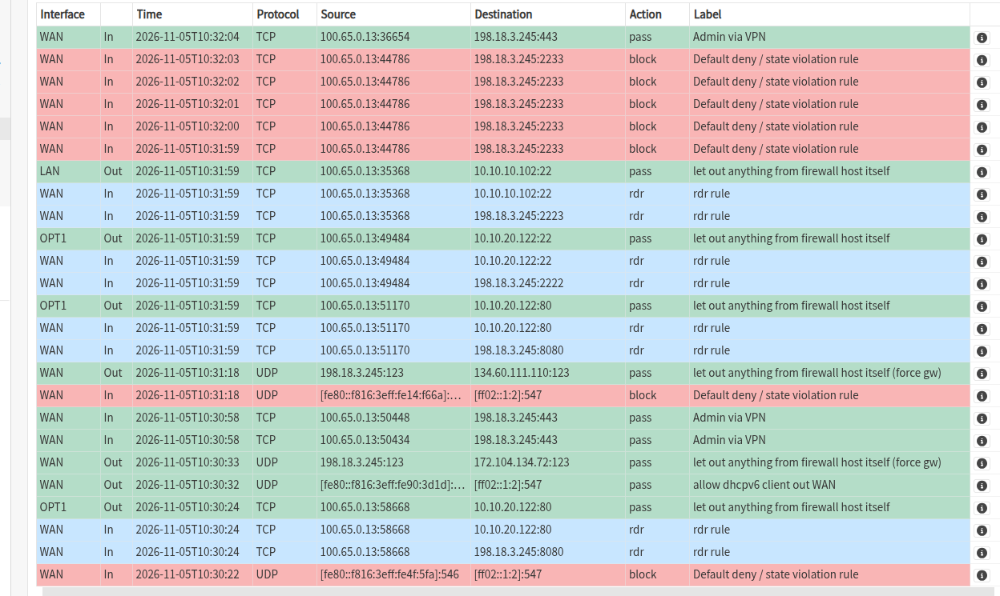
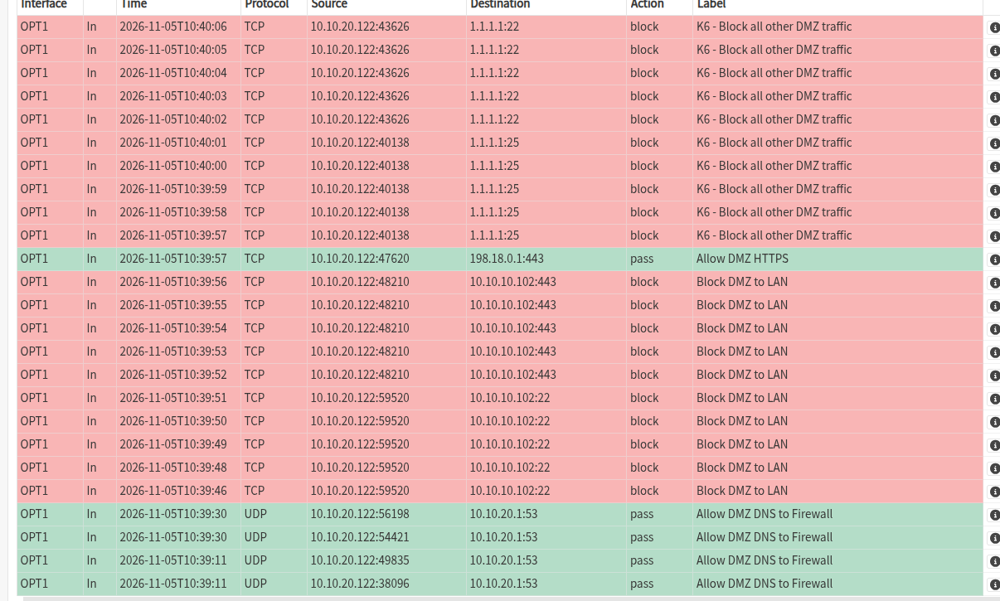
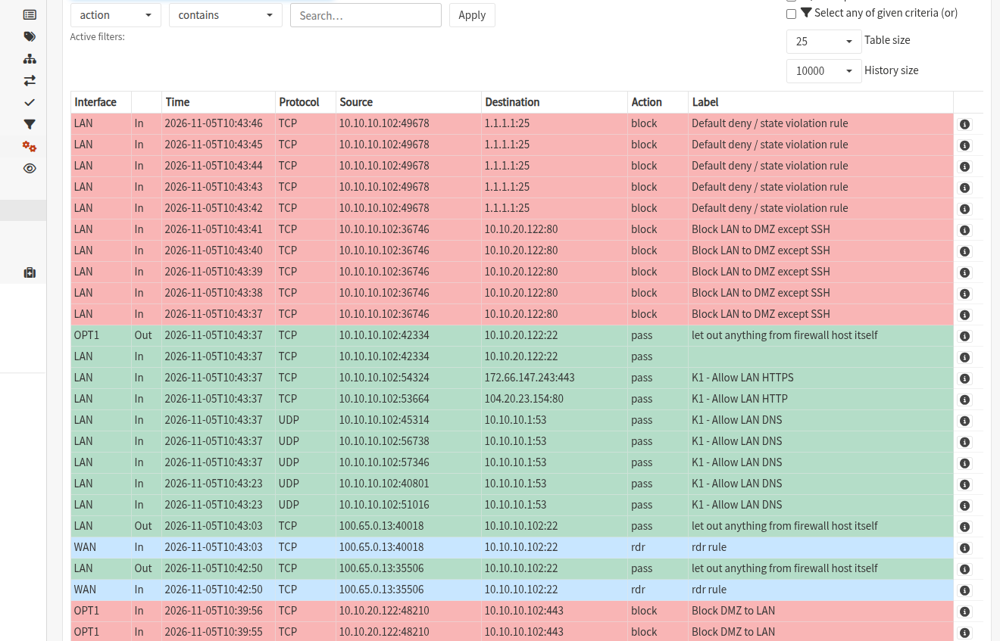

# Lab 01 — OPNsense Firewall, NAT, Policy & Traffic Analysis

## Objective

Build and document a segmented lab with a WAN, LAN and DMZ. Enforce testable communication policies, publish one HTTP service using NAT, restrict administrative access and substantiate findings using connection tests and firewall logs. This exercise follows the *Network Security Lab — Assignment Description and Report Template* (English translation of the course title), v1.0 (2026-11-04); IDS/IPS assessment requirements are issued separately.

## Topology

```text
Mint / WireGuard (100.65.0.13)
             |
WAN 198.18.3.245  [fw01 / OPNsense]
                    |             |
            LAN 10.10.10.1   DMZ 10.10.20.1
                    |             |
           client01          web01 / Apache
           10.10.10.102      10.10.20.122
```

Both internal machines use their corresponding fw01 address as default gateway. Inter-subnet flows route through fw01 and are governed by stateful firewall policies.

## Policy requirements and implementation

| ID | Testable policy statement | Implementation |
|---|---|---|
| P-1 / K1 | client01 can use DNS through fw01 and HTTP/HTTPS outbound | LAN DNS 53 to fw01; TCP 80 and TCP/UDP 443 outbound rules |
| P-2 / K2 | WAN TCP 8080 forwards to web01 TCP 80 | Destination NAT `198.18.3.245:8080 -> 10.10.20.122:80` |
| P-3 / K3 | client01 alone can initiate LAN-to-DMZ SSH; VPN administrator has separate exception | LAN `admin_host -> web_server:22` pass above LAN-to-DMZ block; WAN port forward 2222 restricted to VPN source |
| P-4 / K4 | DMZ cannot initiate connections to LAN | `Block DMZ to LAN` on OPT1 |
| P-5 / K5 | DMZ can resolve DNS via fw01 and reach HTTP/HTTPS outbound | OPT1 DNS-to-firewall, HTTP/HTTPS allow, followed by deny |
| P-6 / K6 | Unspecified traffic denied and logged | Explicit DMZ deny and firewall default deny; log verification |
| P-7 / own | WAN firewall HTTPS administrative access only from VPN source | `100.65.0.13/32 -> This Firewall:443` |

Aliases used: `admin_host=10.10.10.102`, `web_server=10.10.20.122`. Additional WAN SSH forwards: `2222 -> web01:22`, `2223 -> client01:22`, restricted to the VPN source. The WAN HTTP 8080 forward is not limited to the VPN source.

**Rule order matters:** a specific allow for LAN-to-DMZ SSH must precede `Block LAN to DMZ except SSH`. OPT1's `Block DMZ to LAN` must precede general outbound HTTP/HTTPS allowances. Firewall *Save* stages configuration; *Apply* makes changes effective.

## Evidence — 16 test observations

The source write-up reports the 16 results below, collected using test scripts that did not change configuration and corroborated, where applicable, against OPNsense Live View. The scripts and raw terminal output are not included. The screenshots directly show firewall log decisions and NAT translations; they do not independently establish HTTP response codes, DNS answers or SSH authentication. These historical results were not rerun during publication preparation. A successful TCP connect does not establish successful SSH authentication; a timeout alone does not demonstrate the cause of a failure.

| ID | Test | Observation | Corroborating evidence |
|---|---|---|---|
| E01 | Mint -> WAN:8080 | HTTP 200 | WAN NAT `rdr` to web01:80 |
| E02 | Mint -> WAN:2222 | TCP connected | NAT toward web01:22 |
| E03 | Mint -> WAN:2223 | TCP connected | NAT toward client01:22 |
| E04 | Mint -> WAN:2233 (old port) | Failed | WAN `Default deny / state violation` |
| E05 | Mint -> WAN:443 | TCP connected | `Admin via VPN` pass |
| E06 | web01 -> client01:22 | Failed | `Block DMZ to LAN` |
| E07 | web01 -> client01:443 | Failed | `Block DMZ to LAN` |
| E08 | web01 -> 198.18.0.1:443 | Connected | `Allow DMZ HTTPS` |
| E09 | web01 -> 1.1.1.1:25 | Failed | `K6 - Block all other DMZ traffic` |
| E10 | web01 -> 1.1.1.1:22 | Failed | `K6 - Block all other DMZ traffic` |
| E11 | client01 -> fw01 DNS:53 | DNS `NOERROR` | `K1 - Allow LAN DNS` |
| E12 | client01 -> external HTTP | HTTP 200 | `K1 - Allow LAN HTTP` |
| E13 | client01 -> external HTTPS | HTTP 200 | `K1 - Allow LAN HTTPS` |
| E14 | client01 -> web01:22 | Connected | LAN inbound pass, OPT1 outbound pass |
| E15 | client01 -> web01:80 (before IDS lab exception) | Failed | `Block LAN to DMZ except SSH` |
| E16 | client01 -> 1.1.1.1:25 | Failed | `Default deny / state violation` |

### Selected log screenshots

**WAN/NAT** — firewall routing, administrator VPN and rejected legacy SSH port:



**DMZ** — segmentation and allowed HTTPS:



**LAN** — DNS, HTTP, HTTPS, permitted SSH and blocked DMZ HTTP:



## Troubleshooting: forwarded SSH

Port `2233` was the previous mapping for client01. The forwarding was corrected to `2223`, then retested: `2223` connected while `2233` was denied. This distinguished a wrong/obsolete port mapping from a total SSH outage. NAT `rdr` and firewall pass logs were correlated with the client connection test.

## Traffic anomaly assessment (A1–A2)

- **Observed:** repeated TCP attempts `10.10.20.122 -> 10.10.10.102:22,443`; denied by `Block DMZ to LAN` around **2026-11-05 10:39:46–10:39:56 UTC**. Blocked outbound SSH `10.10.20.122 -> 1.1.1.1:22` by K6 at approximately **10:40:02–10:40:06 UTC**.
- **Comparison:** `10.10.20.122 -> 198.18.0.1:443` allowed at **10:39:57 UTC** by `Allow DMZ HTTPS`. Same destination port as a blocked flow, different destination and matching rule.
- **Interpretation:** repeated logs can be TCP retransmissions from one connection attempt, not independent attacks. These were deliberately generated lab tests, **not a confirmed security incident**.
- **Production response:** investigate unexpected DMZ-to-LAN attempts through endpoint/process logs, retain centralized logs and alert on recurrence; review approved application dependencies and create an incident triage procedure. Restrict rules to destinations where feasible.

## Later change for IDS Exercise 1

The subsequent Suricata assignment required HTTP testing from client01 to web01. A deliberately narrow **LAN TCP 80 pass** from `admin_host` to `web_server` was added **above** `Block LAN to DMZ except SSH`; `curl -I http://10.10.20.122` then returned HTTP 200. This is an **exception to the original firewall evidence** (E15), not a claim that E15 remains blocked in the modified live configuration. Reconcile this exception before demonstrating the original K3 policy.

## Lessons learned

- The router and firewall are the same device in this topology: different `/24` networks require Layer 3 forwarding by fw01.
- NAT changes destination addressing; it is not equivalent to a security allow policy.
- Source, destination, interface, protocol and rule ordering govern decisions—not the destination port alone.
- Verification is strongest when a test result is paired with the corresponding firewall log.

## Evidence / Privacy

Only selected screenshots are included; see the [evidence coverage and publication review](../docs/publication-review.md). Lab addresses, example commands and ordinary traffic destinations are retained for context. No firewall backup, SSH key or VPN configuration is included. The policy table describes the reported implementation; full rule exports are unavailable for independent configuration review.

[Back to project overview](../README.md) · [Continue to the Suricata lab](../02-suricata-ids/README.md)
